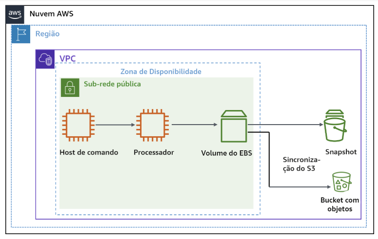
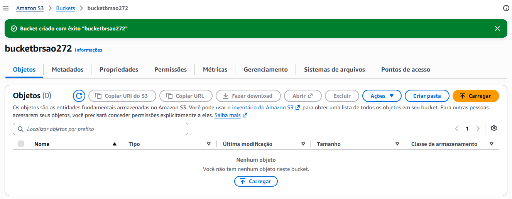
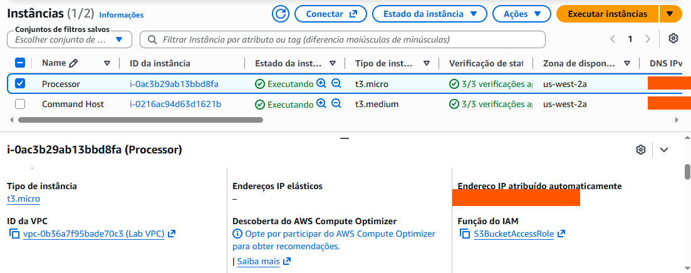
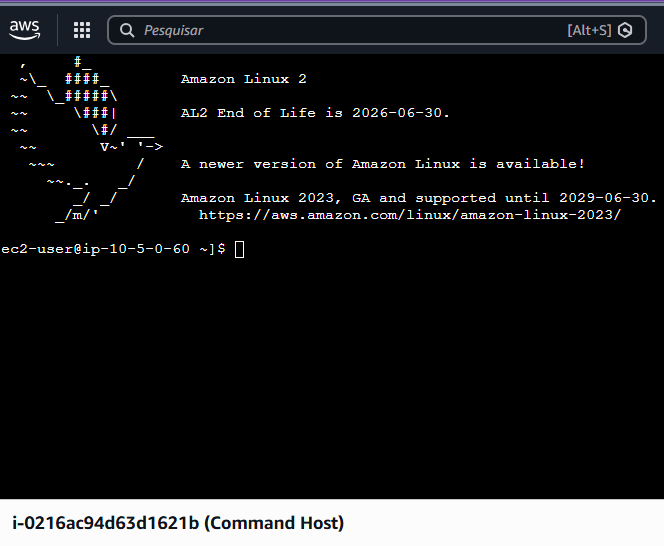
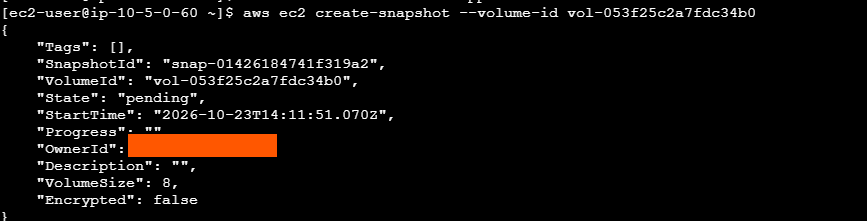
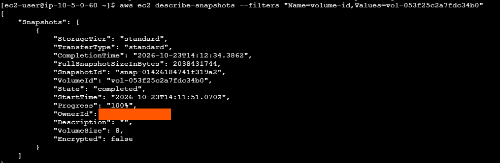
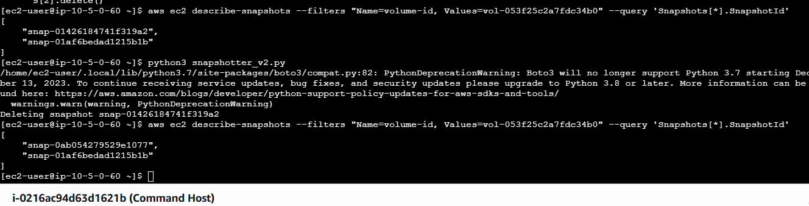
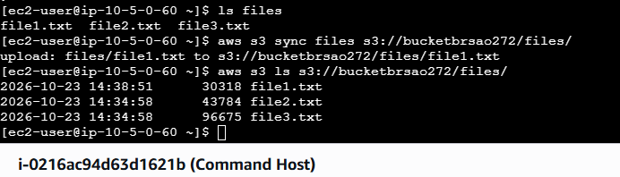

# ☁️ AWS Lab: Gerenciamento de Armazenamento, Snapshots e Sincronização com Amazon S3


## 📌 Visão Geral do Laboratório

Neste laboratório prático (re/Start – Escola da Nuvem), foram exploradas estratégias de gerenciamento de armazenamento na **AWS**, abrangendo automação de backups de volumes **Amazon EBS** via **AWS CLI**, retenção programada de snapshots com **Cron** e **Python (Boto3)**, além do gerenciamento de objetos no **Amazon S3** com versionamento, sincronização e recuperação de arquivos excluídos.

---

## 🏗️ Arquitetura do Laboratório



*Diagrama do roteiro do laboratório.*

A arquitetura implantada é composta por:

- **Command Host (EC2):** instância de controle para execução de comandos de automação via AWS CLI.
- **Processor (EC2):** instância responsável pelo processamento de dados e conexão com o volume EBS.
- **Perfil IAM (`S3BucketAccess`):** permissão de segurança anexada à instância, cuja função aparece no console como `S3BucketAccessRole`, para interação com o S3.
- **Volume EBS:** armazenamento em bloco anexado à instância Processor.
- **EBS Snapshots:** pontos de restauração persistentes do volume.
- **Bucket Amazon S3:** armazenamento de objetos com versionamento ativado para backup e sincronização de dados.

---

## 🎯 Objetivos Concluídos

- [x] Provisionamento e configuração de um **Bucket Amazon S3**.
- [x] Associação de perfis **IAM (Instance Profile)** a instâncias EC2 para acesso seguro aos recursos.
- [x] Automação de snapshots de volumes EBS via **AWS CLI** e **Cronjob**.
- [x] Criação de script de retenção lógica de backups utilizando **Python (Boto3)**.
- [x] Sincronização incremental de dados entre sistema local e S3 (`aws s3 sync`).
- [x] Ativação de **Versionamento no S3** e recuperação de objetos excluídos após desastre simulado.

---

## 🛠️ Tecnologias e Ferramentas

- **Nuvem:** Amazon Web Services (AWS)
- **Serviços AWS:** Amazon EC2, Amazon EBS, Amazon S3, AWS IAM, AWS CLI
- **Linguagens & Scripting:** Bash Shell, Python 3 (Boto3)
- **Ferramentas de SO:** `crontab`, `wget`, `unzip`

---

## 🚀 Passo a Passo e Evidências de Execução

### Tarefa 1: Configuração Inicial de Recursos e Segurança

1. **Criação do Bucket Amazon S3:**
   Provisionamento de um bucket exclusivo para sincronização e backup de arquivos. O bucket começa vazio (0 objetos).

   

2. **Associação do Perfil IAM:**
   Anexado o perfil `S3BucketAccess` (função `S3BucketAccessRole`) à instância `Processor`, para conceder acesso ao S3 sem necessidade de credenciais estáticas.

   

---

### Tarefa 2: Automação e Gerenciamento de Snapshots EBS

1. **Conexão à Instância de Comando:**
   Acesso à instância `Command Host` via **EC2 Instance Connect**.

   

2. **Geração do Snapshot Inicial via CLI:**
   Coleta do `VolumeId` e `InstanceId` da instância `Processor`, interrupção graciosa da instância e criação do snapshot inicial via AWS CLI. O snapshot é criado com o estado `pending`.

   ```bash
   # Obter VolumeId
   aws ec2 describe-instances --filter 'Name=tag:Name,Values=Processor' --query 'Reservations[0].Instances[0].BlockDeviceMappings[0].Ebs.{VolumeId:VolumeId}'

   # Criar Snapshot do volume
   aws ec2 create-snapshot --volume-id <ID_DO_VOLUME>
   ```

   

3. **Verificação do Snapshot:**
   Acompanhamento do snapshot com `describe-snapshots` até o estado `completed` (`Progress: 100%`). O snapshot do volume de 8 GiB levou cerca de 40 segundos.

   ```bash
   aws ec2 describe-snapshots --filters "Name=volume-id,Values=<ID_DO_VOLUME>"
   ```

   

4. **Snapshots Recorrentes (Cron) e Retenção com Python:**
   Agendamento da criação recorrente de snapshots com **Cron** e execução do script de retenção `snapshotter_v2.py`, escrito em **Python (Boto3)**. O script removeu o snapshot mais antigo e deixou apenas os dois mais recentes.

   ```bash
   python3 snapshotter_v2.py
   aws ec2 describe-snapshots --filters "Name=volume-id,Values=<ID_DO_VOLUME>" --query 'Snapshots[*].SnapshotId'
   ```

   

---

### Tarefa 3: Sincronização com Amazon S3 e Versionamento

1. **Sincronização Incremental:**
   Sincronização da pasta `files` (3 arquivos) com o bucket. Como só o `file1.txt` precisava ser enviado, o `aws s3 sync` transferiu **apenas esse arquivo**. Em seguida, o conteúdo do bucket foi listado com `aws s3 ls`.

   ```bash
   aws s3 sync files s3://<NOME_DO_BUCKET>/files/
   aws s3 ls s3://<NOME_DO_BUCKET>/files/
   ```

   

2. **Versionamento e Recuperação:**
   Ativação do **versionamento** no bucket e recuperação dos objetos excluídos após um desastre simulado, a partir das versões anteriores mantidas pelo S3.

---

## ✅ Resultados

- Bucket S3 criado e perfil IAM associado à instância
- Snapshot do volume EBS criado e concluído pela AWS CLI
- Snapshots recorrentes agendados e retenção controlada por script em Python
- Arquivos sincronizados com o S3 de forma incremental
- Objetos excluídos recuperados com o versionamento do S3

## 📚 Aprendizados

- Snapshots EBS são incrementais: depois do primeiro, só os blocos alterados são armazenados
- Scripts de retenção evitam que snapshots recorrentes se acumulem e aumentem o custo
- O `aws s3 sync` compara os arquivos e envia só o que mudou
- O versionamento do S3 protege contra exclusões e sobrescritas acidentais
- Perfis IAM em instâncias EC2 são mais seguros do que guardar chaves de acesso dentro da máquina
- O terminal do laboratório mostra o aviso de fim de vida do Amazon Linux 2 (30/06/2026), e o Boto3 emite um aviso de depreciação do Python 3.7. Em ambientes reais, convém usar Amazon Linux 2023 e uma versão atual do Python

## ⚠️ Segurança

IDs de conta e endereços IP públicos foram ocultados nos prints deste repositório.

## 👩‍💻 Autora

**LUCIANA RB DE ASSIS**

[LinkedIn](https://www.linkedin.com/in/lucianarbassis/) · [GitHub](https://github.com/alra-code)
